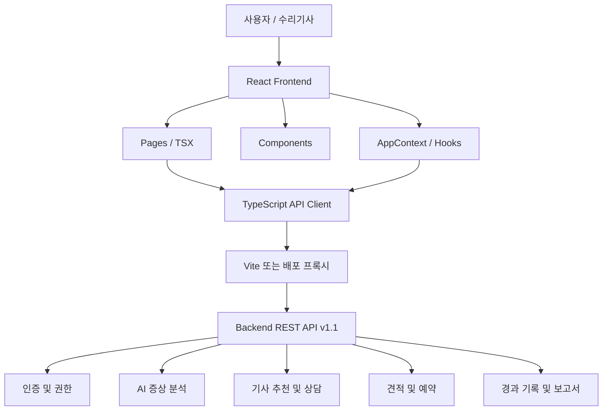

# 🏠 고쳐야집 (Gochyeoyajip)

> 혼자서도 뚝딱, 고쳐야ZIP!  
> 사진과 AI 상담으로 우리 집 문제를 파악하고, 셀프 수리·공식 AS·수리기사 연결까지 이어주는 홈케어 웹 플랫폼

---

## 1. 프로젝트 소개

고쳐야집은 집 안의 고장 사진과 증상을 등록하면 AI가 문제 파악을 돕고, 사용자가 **셀프 수리 가이드 / 제조사 공식 AS / 전문 수리기사 연결** 중 적합한 해결 방법을 선택할 수 있도록 지원하는 모바일 웹 플랫폼입니다.

### 주요 서비스 흐름

1. 고장 사진 및 증상 등록
2. AI 증상 분석 및 추가 문답
3. 분석 결과 확인 및 사용자 수정
4. 맞춤형 해결 방법 안내
   - 검증된 셀프 수리 가이드
   - 제조사 공식 AS 안내
   - 전문 수리기사 연결
5. 기사 상담 및 견적 비교
6. 방문 예약 및 수리 진행
7. 날짜별 경과 기록 및 인계 보고서 관리

본 프로젝트는 웹 브라우저에서 실행되는 **모바일 웹 애플리케이션(Web App)** 입니다.

iPhone 비율의 모바일 UI를 제공하지만 React Native나 네이티브 앱은 아닙니다.

---

## 2. 프론트엔드 기술 스택

| 구분 | 기술 | 역할 |
|---|---|---|
| UI 라이브러리 | React 19 | 컴포넌트 기반 화면 구성 및 렌더링 |
| 개발 언어 | TypeScript | 타입 검사 및 데이터 구조 관리 |
| UI 문법 | TSX | React 컴포넌트 마크업 |
| 빌드 도구 | Vite 7 | 개발 서버 및 배포 빌드 |
| 스타일링 | CSS3 | 반응형 UI, 애니메이션, 디자인 시스템 |
| API 통신 | Fetch API | 백엔드 REST API 연동 |
| 인증 | Session Cookie | 로그인 세션 및 역할 관리 |
| 라우팅 | Hash 기반 자체 라우팅 | 화면 이동 및 URL 상태 관리 |

### React 전환 구조

기존 프론트엔드는 HTML, CSS, Vanilla JavaScript로 구현되었습니다.

현재 프로젝트는 이를 React + TypeScript 기반으로 재구성한 버전입니다.

- 기존 JavaScript의 HTML 문자열 렌더링 구조 제거
- React TSX 컴포넌트 기반 화면 구성
- React Context 기반 공통 상태 관리
- TypeScript 기반 API 통신 모듈
- 기존 백엔드 API v1.1 사용
- 기존 CSS 디자인 및 아이콘 자산 활용

현재 프로젝트에는 기존 `src/legacy/`에 의존하는 화면 렌더링 구조가 없습니다.

단, 전체 React 전환과 모든 요구사항의 기능 구현·실서버 검증 완료는 별개의 사항입니다.

---

## 3. 실행 방법

### 3.1. 사전 준비

다음 프로그램이 필요합니다.

- Visual Studio Code
- Node.js (20.19 이상 또는 22.12 이상 권장)
- npm
- 최초 패키지 설치를 위한 인터넷 연결

Node.js 설치:
https://nodejs.org/

### 3.2. 프로젝트 실행

1. 프로젝트 ZIP 파일을 압축 해제합니다.
2. VSCode에서 프로젝트 폴더를 엽니다.
3. `package.json` 파일이 있는 폴더인지 확인합니다.
4. VSCode 터미널에서 아래 명령어를 실행합니다.

#### Node.js 및 npm 버전 확인

```powershell
node -v
npm -v
```

#### 패키지 설치

```powershell
npm install
```

#### 개발 서버 실행

```powershell
npm run dev
```

브라우저에서 아래 주소로 접속합니다.

http://localhost:5173/

개발 서버를 종료하려면 터미널에서 `Ctrl + C`를 입력합니다.

> 기존 Vanilla JavaScript 버전에서 사용한 `py serve.py`는 React 버전에서 사용하지 않습니다.

### 3.3. 타입 검사 및 빌드

```powershell
npm run typecheck
npm run build
```

빌드가 성공하면 `dist/` 폴더가 생성됩니다.

빌드 결과를 확인하려면 다음 명령어를 실행합니다.

```powershell
npm run preview
```

일반적인 미리보기 주소는 다음과 같습니다.

http://localhost:4173/

### 3.4. 오류 발생 시

| 오류 | 확인 사항 |
|---|---|
| node 명령어를 찾을 수 없음 | Node.js 설치 확인 |
| react 모듈을 찾을 수 없음 | `npm install` 재실행 |
| 5173 포트 사용 중 | 이전 개발 서버 종료 |
| TypeScript 오류 | 오류 파일과 줄 번호 확인 |
| API 연결 오류 | 백엔드 상태 및 Vite 프록시 설정 확인 |
| 로그인 오류 | 세션 쿠키 및 API 응답 확인 |

---

## 4. 프로젝트 폴더 구조

```text
gochyeoyajip-react/
│
├── index.html
├── package.json
├── tsconfig.json
├── vite.config.ts
├── vercel.json
│
├── public/
│   └── assets/
│       └── 앱 아이콘 및 일러스트
│
├── src/
│   ├── main.tsx
│   ├── App.tsx
│   │
│   ├── components/
│   │   ├── AppFrame.tsx
│   │   ├── PhoneStatus.tsx
│   │   └── UI.tsx
│   │
│   ├── context/
│   │   └── AppContext.tsx
│   │
│   ├── pages/
│   │   ├── AuthPage.tsx
│   │   ├── HomePage.tsx
│   │   ├── NewRequestPage.tsx
│   │   ├── RequestsPage.tsx
│   │   ├── DetailPage.tsx
│   │   ├── AIPage.tsx
│   │   ├── SolutionsPage.tsx
│   │   ├── ExpertsPage.tsx
│   │   ├── CandidatesPage.tsx
│   │   ├── ConsultationsPage.tsx
│   │   ├── QuotesPage.tsx
│   │   ├── BookingsPage.tsx
│   │   ├── RecordsPage.tsx
│   │   ├── ReportPage.tsx
│   │   ├── ProfilePage.tsx
│   │   └── TechnicianPages.tsx
│   │
│   ├── services/
│   │   └── api.ts
│   │
│   ├── hooks/
│   │   └── useRemote.ts
│   │
│   ├── types/
│   │   └── models.ts
│   │
│   ├── lib/
│   │   └── format.ts
│   │
│   └── styles/
│       ├── base.css
│       └── react.css
│
├── contracts/
├── docs/
└── tests/
```

---

## 5. 주요 파일 설명

| 파일 및 디렉터리 | 역할 |
|---|---|
| `src/main.tsx` | React 애플리케이션 실행 진입점 |
| `src/App.tsx` | 현재 경로에 따른 화면 렌더링 |
| `src/pages/` | 사용자·기사 기능별 페이지 |
| `src/components/` | 공통 UI 컴포넌트 |
| `src/context/AppContext.tsx` | 로그인, 화면 이동, 공통 상태 관리 |
| `src/services/api.ts` | 백엔드 API 요청 및 응답 처리 |
| `src/hooks/useRemote.ts` | 비동기 데이터 조회 로직 |
| `src/types/models.ts` | TypeScript 데이터 타입 |
| `src/styles/` | 전체 CSS 디자인 |
| `public/assets/` | 브랜드 아이콘 및 이미지 자산 |
| `vite.config.ts` | Vite 개발 서버 및 API 프록시 설정 |

### 기능별 수정 위치

- 홈 화면 → `HomePage.tsx`
- AI 분석 및 문답 → `AIPage.tsx`
- 수리 요청 → `NewRequestPage.tsx`, `RequestsPage.tsx`
- 요청 상세 → `DetailPage.tsx`
- 기사 찾기 → `ExpertsPage.tsx`
- 기사 추천 → `CandidatesPage.tsx`
- 견적 비교 → `QuotesPage.tsx`
- 방문 예약 → `BookingsPage.tsx`
- 경과 기록 → `RecordsPage.tsx`
- 인계 보고서 → `ReportPage.tsx`
- 기사 모드 → `TechnicianPages.tsx`
- API 수정 → `services/api.ts`

---

## 6. 프론트엔드 아키텍처



### 프론트엔드 처리 흐름

1. 사용자가 React 화면에서 기능을 선택합니다.
2. React 컴포넌트가 입력 데이터와 화면 상태를 관리합니다.
3. API 클라이언트가 백엔드에 요청을 전송합니다.
4. 백엔드에서 실제 데이터와 업무 규칙을 처리합니다.
5. API 응답을 React 상태에 반영합니다.
6. 변경된 상태에 따라 화면이 다시 렌더링됩니다.

### 프론트엔드와 백엔드 역할

프론트엔드는 화면 구성, 사용자 입력, 상태 관리, API 요청, 응답 표시를 담당합니다.

백엔드는 인증과 권한, AI 분석, 기사 추천, 예약 충돌 검사, 데이터 저장, 보고서 생성 등을 담당합니다.

---

## 7. 백엔드 API 연동

### API 정보

Backend Base URL:

```text
https://torysv.kro.kr/fixmyhome/api/v1
```

Swagger:

https://torysv.kro.kr/fixmyhome/api/docs

### 연동 방식

프론트엔드에서는 다음 상대 경로를 사용합니다.

```text
/api/v1
```

로컬 개발 환경에서는 `vite.config.ts`의 프록시가 실제 백엔드로 요청을 전달합니다.

API 통신은 `src/services/api.ts`에서 관리합니다.

### 인증 및 권한

- 로그인은 백엔드 세션 쿠키 기반입니다.
- 일반 회원가입은 USER 역할로 생성됩니다.
- TECHNICIAN 역할은 백엔드에서 허용된 계정만 사용할 수 있습니다.
- 허용된 역할 간 전환에는 `PATCH /auth/role`을 사용합니다.
- 프론트엔드는 서버에서 허용하지 않은 역할을 임의로 부여하지 않습니다.

---

## 8. 주요 서비스 기능

### 사용자 기능

- 회원가입 및 로그인
- 사진·증상 등록
- AI 증상 분석 및 추가 문답
- 증상 요약 확인 및 수정
- 셀프 수리 가이드
- 제조사 공식 AS 안내
- 기사 탐색 및 추천
- 기사 상담
- 견적 조회·비교
- 방문 예약
- 수리 진행 상태 확인
- 날짜별 사진·경과 기록
- 인계 보고서 및 PDF 관련 기능
- 계정 및 자료 관리

### 기사 기능

- 기사 프로필 관리
- 전문 분야 및 활동 지역 관리
- 수리 사례·포트폴리오 관리
- 상담 요청 관리
- 견적 발행 및 수정
- 방문 가능 일정 관리
- 동선 관련 정보 조회
- 예약 및 실제 작업 상태 관리

실제 이용 가능 여부는 계정 권한과 서버 데이터에 따라 달라집니다.

---

## 9. 현재 개발 및 검증 상태

현재 소스는 기존 Vanilla JavaScript 화면을 React + TypeScript 구조로 재구성한 프론트엔드입니다.

그러나 모든 요구사항을 최종적으로 충족했다는 의미는 아닙니다.

| 검사항목 | 상태 |
|---|---|
| React + TypeScript 구조 전환 | 소스 재구성 완료 |
| 기존 Legacy 렌더링 구조 제거 | 완료 |
| TypeScript 정적 검사 | 일부 검사 통과 기록 |
| 모의 API 기반 화면 검사 | 일부 검사 통과 기록 |
| 실제 로컬 npm 빌드 | 개발자 PC에서 최종 확인 필요 |
| API 80개 실서버 전수검사 | 미완료 |
| FR 91개 전체 요구사항 충족 | 미확정 |
| AC 63개 실제 인수검사 | 미완료 |
| AI 정량 평가 240회 | 미실시 |

추가 구현 및 검증 대상은 다음 문서를 참고합니다.

- `docs/REMAINING_WORK.md`
- `docs/API_PATH_AUDIT.md`

현재 자료 기준으로 API 80개 중 일부 경로는 코드 참조가 확인되지 않았으며, 전체 구현 누락 점검도 추가로 필요합니다.

---

## 10. 협업 및 개발 방향

현재 프로젝트는 React 컴포넌트 기반으로 구성되어 있으므로 기능별로 작업을 분담할 수 있습니다.

권장 작업 구분:

- 사용자 화면 및 AI 상담
- 기사 탐색·추천·상담
- 견적·예약
- 경과 기록·보고서
- 기사 모드
- API 연동 및 공통 상태 관리
- 디자인 시스템 및 공통 UI

수정할 때는 기존 API v1.1 명세와 요구사항을 기준으로 기능이 누락되지 않도록 주의해야 합니다.

특히 화면 디자인 수정과 실제 서버 기능 검증은 별도로 진행합니다.

장기적으로는 공통 컴포넌트 재사용, 기능별 모듈화, API 타입 정의, 자동 테스트를 확장하는 방향을 권장합니다.

---

## 11. 개발 시 주의사항

1. 기존 백엔드 API 계약을 임의로 변경하지 않습니다.
2. 인증 정보와 비밀번호를 소스코드에 저장하지 않습니다.
3. 가상의 기사·견적·예약 데이터를 실제 데이터처럼 표시하지 않습니다.
4. React 컴포넌트에서 DOM을 직접 수정하는 코드를 가급적 사용하지 않습니다.
5. 공통 UI와 상태 처리는 재사용 가능한 구조로 관리합니다.
6. 기능 수정 후 TypeScript 검사와 브라우저 동작 검사를 진행합니다.
7. 예약·삭제 등 실제 서버 데이터를 변경하는 검사는 테스트용 계정과 데이터로 수행합니다.
8. 검증하지 않은 요구사항을 완료로 표시하지 않습니다.

---

## 12. 팀원 참고

현재 고쳐야집 프론트엔드는 **React 19 + TypeScript + Vite 7 기반의 모바일 웹앱**입니다.

기존 HTML/CSS/Vanilla JavaScript 구조를 React 컴포넌트 기반으로 재구성했으며, 실제 배포된 고쳐야집 Backend REST API v1.1과 연결하는 방식입니다.

### 실행 명령어

```powershell
npm install
npm run dev
```

접속 주소:

http://localhost:5173/

### 참고사항

기존 프론트엔드의 주요 화면과 기능 흐름을 React로 옮겨 두었지만, 전체 요구사항과 API의 실서버 전수검증은 아직 완료되지 않았습니다.

기능 누락 여부와 실제 서버 동작을 추가로 검토해야 하며, 기획 의도나 사용자 흐름과 다른 부분이 있다면 요구사항 명세서를 기준으로 수정할 수 있습니다.
